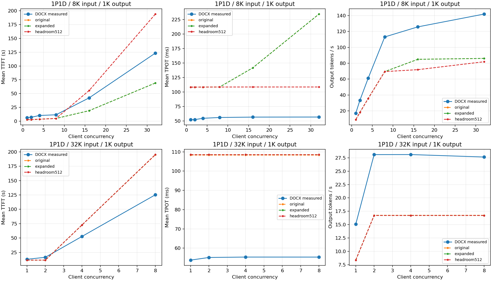

# 910C 算子 shape 扩充与实测偏差排查

更新日期：2026-10-29。硬件是当前 node20，沿用此前固定的 SGLang-Ascend 0.5.22 镜像和计时协议。

**当前 8K/1K、32K/1K 的首要问题已经不是 shape 数量不足。**这轮新增 2,165 个有效测量点并入库，
重新运行了 DOCX 中对应的 50 组 PD 配置。新增的大范围覆盖几乎不改变这 50 组结果；现有算子诊断均为
`silicon`，没有报告范围外估计。后续应优先核对实际调度参数、MoE/通信执行与重叠关系，再针对缺口补测。

`silicon` 包括测量范围内插值，不表示每轮的每个坐标都直接实测过；组合算子的汇总来源也不是完整的内部查询追踪。
“能预测任意长度”“对应 shape 有实测数据”“整机预测准确”是三个不同的验收项目。

## 1. 这轮实际增加了什么

| 数据表 | 扩充前 | 新增有效点 | 扩充后 |
|---|---:|---:|---:|
| Attention / Indexer | 2,577 | 1,638：先补 268，再补 1,370 | 4,215 |
| Linear / GEMM | 2,645 | 243 | 2,888 |
| MLA BMM | 366 | 68 | 434 |
| Vector / 归一化等 | 1,194 | 216 | 1,410 |
| 合计 | 6,782 | **2,165** | **8,947** |

新增范围主要包括：

- Attention / Indexer 的长 prefix、长上下文和 32K prefill token 规模；decode 上下文测到 132,096，即 128K 输入加 1K 输出。
- 稀疏注意力 local heads 为 4/8/16/32/64，沿用对应 TP 布局；Indexer 维度按模型结构固定。
- 本次长上下文 eager prefill 选择 active batch 1/2/4；decode 沿用图桶 8/16/24/32 及原有活跃请求数网格。
- Linear、BMM、Vector 增加较大的 token/M 维度，包括 12K、24K、32K 附近缺点，具体范围以各表完整键为准。

这些范围是多个维度的覆盖汇总，**不是完整笛卡尔积**。“有 128K 点”和“有 batch32 点”，
不能推断任意 TP、任意执行模式下都存在 `128K × batch32` 的实测。
图桶仍最大为 32，本轮没有将更大的 decode 图桶变成已验证配置。

测量使用固定镜像摘要 `5f384cab0e16…`、框架提交 `baa9befa3815…`，保持原有 dtype、量化方式、布局、
collector 主体和计时协议。不同协议的 Linear 曲线分别扩充，没有混用计时条件。

后续批次共 1,897 个新坐标，首次有 3 个点 CV 超过 10%：两个 Attention/Indexer 点、一个 Vector 点。
保留全部原始记录，只对三个缺口单独复测一次，复测 CV 分别约 8.96%、5.66%、0.28%，合格后补入。
没有从多个合格重复样本中挑最快值，也没有覆盖既有合格测量。

四张表全部 8,947 行通过 Rust 原生算子查询验证，实测坐标查询的最大绝对误差为 0。
这是数据接入检查，不是整轮 forward 或端到端准确率为 100%。
原始样本、失败记录、负对照、方案、质量报告和入库前后数据见
[采集清单](../benchmarks/evidence/ascend910c-glm52-w8a8/production/shape-expansion-node20-20261029/manifest.json)
与同目录 `raw-evidence.tar.gz`，清单包含归档及逐文件 SHA256。

## 2. DOCX 基线如何对比

源文件是用户提供的 `不同 PD Ratio的Baseline.docx`，SHA256 为
`db38316f640ddcb0880a651063edb8b59874a5d569daf192b59ab4b7d5fe082f`。
直接读取 24 个嵌入 Excel 表，提取 107 条记录，没有使用截图 OCR。
表头标的是 **mean / p99**，因此不能把这些 mean 指标与预测 p50 直接比较。

本轮比较五种 PD 部署的 8K/1K、32K/1K，共 50 个点：

- 8K/1K 的请求数为并发的两倍；32K/1K 的请求数等于并发，是有限的一轮请求。
- P/D 都采用 attention TP8、ADP2、MoE TP1、EP16；一个 replica 是一个 16-device 节点。
- P/D 显存比例为 0.88/0.90，上下文 180,000，调度上限 64，关闭前缀复用。
- 输入输出长度按 workload 名称取固定 token 数；历史逐请求 tokenized trace 不存在。

**发现了一个必须纠正的配置解释：**公共字段 `scheduler.max_batched_tokens` 不控制当前 SGLang replay 的实际 chunk。
SGLang replay 使用原生默认全局 chunk 8,192，ADP2 后每 rank 为 4,096。
DOCX 部署写的是全局 chunk 16,384，另有 `max-prefill-tokens=32768`。
仅把 `max_batched_tokens` 设成 16,384，不能声称已对齐部署。
此差异已记录在对比脚本并修正使用说明；原生参数的独立公共配置仍需继续补齐。

其他未对齐项包括历史镜像/CANN/HCCL 精确版本、请求到达时刻、P 的 cache-aware 路由、
P 的 `TASK_QUEUE_ENABLE=1`、启动时真实 KV 容量、每个 rank 的 batch 时间线。
这些对比可以定位问题，但不是同环境精度验收。

## 3. 结果说明了什么

以下为新增全部 shape 后、保持原有 admission 行为的 1P1D 结果：

| workload / 并发 | 实测 TTFT/s | 预测 TTFT/s | 实测 TPOT/ms | 预测 TPOT/ms | 实测输出tok/s | 预测输出tok/s |
|---|---:|---:|---:|---:|---:|---:|
| 8K/1K / 1 | 6.305 | 2.771 | 52.47 | 108.50 | 17.07 | 9.00 |
| 8K/1K / 32 | 123.417 | 69.168 | 56.91 | 234.28 | 141.90 | 86.06 |
| 32K/1K / 1 | 12.918 | 11.500 | 53.80 | 108.58 | 15.07 | 8.35 |
| 32K/1K / 2 | 16.414 | 11.500 | 55.17 | 108.58 | 28.10 | 16.71 |
| 32K/1K / 4 | 52.770 | 72.789 | 55.38 | 108.58 | 28.11 | 16.71 |
| 32K/1K / 8 | 125.314 | 195.367 | 55.37 | 108.58 | 27.65 | 16.71 |

50 点的绝对相对误差中位数约为 TTFT 54.14%、TPOT 99.93%、吞吐 41.02%。
完成第一批 268 点后，再增加 1,897 点，50 组配置的五项对比指标最大变化仅为浮点舍入量级。
新覆盖对更长上下文和更大矩阵有价值，但不是现有两倍 TPOT 偏差的解决办法。

在 TP8 / ADP2 / EP16、decode batch1 的原生拆分查询中，按 75 层 MoE 累计：

- dispatch 约 23.36 ms；
- combine 约 22.21 ms；
- expert compute 约 17.46 ms。

三项已约 63.03 ms，而历史实测整轮 TPOT 常在 55 ms 左右，完整 MoE 组合还包含其他操作。
这把检查重点指向实际 MoE/通信调用、图捕获、输入负载和重叠关系，
但**不能据此断言哪一项恰好多算一倍**。没有给原始算子数据或最终 TPOT 乘拟合系数。

完整结果见[对比报告](../benchmarks/evidence/ascend910c-glm52-w8a8/production/baseline-comparison-node20-20261029/report.json)
和[CSV](../benchmarks/evidence/ascend910c-glm52-w8a8/production/baseline-comparison-node20-20261029/comparison.csv)。



## 4. 并发为什么不能直接当作 running batch

客户端并发包括排队、P 计算、等待 D 接收、KV 传输、D 计算等状态。
单个 D rank 的 running batch 还受 KV 容量、ADP 分流、接收预算限制。

这组模拟配置的 D rank 可用 KV 容量约为 `406 × 128 = 51,968` token。
两个 32K 输入、1K 输出请求需要约 `2 × (32768 + 1024) = 67,584` token，超过一个 rank 容量。
因此 ADP2 的一个 D worker 同时容纳的长请求数量很小；客户端并发从 2 增到 8，主要可能增加等待。
这是当前模拟配置的容量估计，不是 DOCX 那次运行已测得的真实 KV pool。

实测 1P1D 的 32K/1K 在并发 2/4/8 时，吞吐约 28 token/s、TPOT 约 55 ms，而 TTFT 显著增长，与此现象相符。
`吞吐 × TPOT × (输出长度−1)/输出长度` 可以辅助估计整个有限测试区间的平均 decode 占用，
但它包含填充与排空，不能当作某个 rank 某一时刻的实际 running batch。

## 5. 已补的 PD decode 接收预算

这轮增加可选字段：

```yaml
engine:
  workers:
    decode:
      scheduler:
        decode_reserved_tokens: 512
```

它依据固定框架版本的 decode admission 行为，为运行、传输、等待激活的请求保留增长预算，
考虑被撤回请求及单请求完成空间限制。它是逻辑接收门槛，不会增加 KV 传输字节。
也补了撤回请求优先恢复，防止待接收请求与撤回请求相互等待。
默认 0 保持此前行为；推荐搜索、保存候选 YAML、再 predict 都保留该值。

同样 50 点开启 512 后全部完成。1P1D 的 8K/1K、并发 32：

| 指标 | 旧接收行为 | 开启预算512 | DOCX实测 |
|---|---:|---:|---:|
| 请求重新进入调度的总次数 | 26 | 0 | 无该项记录 |
| mean TPOT/ms | 234.28 | 108.66 | 56.91 |
| mean TTFT/s | 69.17 | 194.19 | 123.42 |
| 输出token/s | 86.06 | 81.87 | 141.90 |

预算避免了这组模拟中的频繁撤回，使等待更多发生在接收前，**不能解决单步耗时偏差**。
整体误差没有全面改善：50 点 TPOT 绝对相对误差中位数仍约 96.97%，TTFT 55.58%，吞吐 42.66%。
不能把行为补齐当成精度校准完成。

## 6. 接下来需要补什么

| 优先级 | 工作 | 原因 |
|---|---|---|
| 最高 | 对齐有效chunk、max-prefill、调度、KV容量、运行版本 | 先消除配置差异，尤其TTFT和排队误差 |
| 最高 | 同版本实际路径测decode batch1/2/4的MoE整块、整轮forward | 低batch已有两倍TPOT偏差，需要核对组合边界与重叠 |
| 次高 | 采真实专家token分布、热点专家及dispatch/combine消息规模 | balanced/single-expert等合成分布不等于真实路由 |
| 按需 | 补新workload查询的estimated、缺失键、不稳定插值区域 | 按实际查询频率和耗时占比选择，不均匀加密所有维度 |
| 按需 | 新图桶、更大active batch、新TP/EP/拓扑、新内核版本 | 执行身份变化不能用输入输出长度外推代替实测 |

现有 MoE chain 为 225 点，张量并行 MoE 为 126 点，DeepEP 为 143 点，HCCL 为 449 点。
具体维度见采集清单，也不构成任意部署的完整实测网格。

目前 node20 的 `/mnt/raid/user/data/models/glm-q/config.json` 不存在，本轮离线回放使用仓库保存的真实模型元数据。
离线预测不需要完整权重；启动完整模型、采真实路由或完整 forward 时需要可访问的权重和部署。
本次没有把合成算子微基准当作新采到的整机实测。

## 7. 运行与证据位置

仍使用 `predict` / `recommend`。在仓库根目录执行，缺少原模型目录时可用元数据快照：

```bash
model_metadata="$PWD/benchmarks/evidence/ascend910c-glm52-w8a8/production/deepep-contract-node19-20261024/model-metadata"
AISIMULATE_910C_MODEL="$model_metadata" bash scripts/run-ascend910c.sh predict \
  --stack engine \
  --config examples/cli/ascend910c-glm52-pd-8k1k.yaml \
  --set "engine.model=$model_metadata" \
  --set engine.context_length=180000 \
  --set traffic.source.input_tokens=32768 \
  --set traffic.source.output_tokens=1024 \
  --set traffic.load.concurrency=2 \
  --set traffic.stop.requests=2 \
  --set engine.workers.decode.scheduler.decode_reserved_tokens=512 \
  --detail memory,time,source \
  --output-dir aisimulate-output/my-32k1k-check
```

这是使用示例；逐点基线对比以 `production/replay_pd_baseline.py` 生成的完整配置为准。
采集证据归档采用仓库相对路径，可以先按清单校验 SHA256，再解压到空目录。

阶段提交：`73cbb896` 扩展采集与增量接入，`263c518b` 可选PD预算，
`b39d8f57` 正式入库2,165点及归档原始证据。
本次算子扩充已完成；完整 serving 准确率和正式 FPM onboarding 验收仍未完成。
