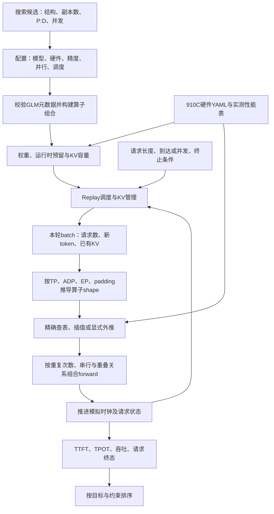

# 910C + GLM-5.2 W8A8：适配实现与GPU版逻辑对比

更新时间：2026-10-25。本文依据当前仓库源码及已保存的采集证据，解释已经实现的部分。
运行命令见 [使用说明](910c-glm52-w8a8-usage.md)，历史阶段见
[适配进展](910c-glm52-w8a8-production-progress.md)。

## 1. 与GPU版到底是不是一样的逻辑

**上层的配置、forward预测接口、请求模拟和搜索框架共用；底层的模型执行拆分、
算子耗时数据、量化、通信和KV布局按910C及当前GLM权重专门适配。**
可以沿用 `predict/recommend --stack engine` 的使用方式，但不能认为换一个硬件名称就能
复用GPU算子表，也不能认为GPU所有模型和部署方式已经在910C上具备同样支持。

这里的“GPU版”指本仓库中NVIDIA GPU的对应实现，不泛指所有版本和所有模型。

| 层次 | 是否共用 | 910C适配的内容 |
|---|---|---|
| CLI与YAML配置 | 共用 | 添加 `ascend910c` 数据与示例，保留已有字段名称 |
| 性能模型入口 | 共用 | 经 `ForwardPassPerfModel::best_available` 构建，选择 `op_level` |
| forward组合机制 | 共用 | 都由算子、重复次数、串行和重叠关系组成；GLM的算子清单按NPU实际路径构建 |
| GEMM/Attention/MoE耗时 | 方法相通，实现和数据不同 | 新增Ascend算子类型、查询身份与实测表，不调用A100/H100计时表代替 |
| shape插值与外推 | 方法相通，策略不同 | GPU部分算子有实测/经验/roofline模式；Ascend明确区分 `measured` 与 `anchored` |
| 权重和KV容量 | 共用容量框架，专用参数 | ModelSlim权重表示、BF16 latent/RoPE/indexer缓存、页及预留内存 |
| 请求到达、排队、调度、指标汇总 | 共用Replay/engine框架 | 使用SGLang调度模型，将forward时间提供给模拟时钟 |
| PD生命周期 | 共用 | 目标KV预留、传输、激活和源端释放继续走通用流程；传输时间换成Ascend实测曲线 |
| 配置搜索与评分 | 共用 | 注入已支持的910C并行结构，仍使用通用预算、容量检查、候选评估和评分 |
| 真实服务启动 | 不是这条离线链的功能 | 预测不启动SGLang、不加载完整权重；所选配置需映射回United/PD部署脚本 |

因此，“同一套框架能用”与“所有能力、误差都完全等价”是两个不同结论。
目前可以离线预测和搜索已支持的合并/PD配置；完整服务误差校准和部分长上下文高并发问题仍未完成。

## 2. 整条离线预测链



模型的78层结构相对固定，**每轮batch及其算子shape会随调度变化**。
所以离线预测不是读取一条“8K/1K总耗时”，也不是把一次decode耗时固定乘1024。
它对调度产生的forward调用进行估计，再模拟请求之间的相互影响。

Python负责配置解析、模型结构组装及搜索组织，性能计算的生产路径在Rust中执行。
`op_level` 表示forward由算子组合估计；它与另行采集整轮forward profile的FPM数据路线不同。
现有算子适配成功不等于已经完成整轮FPM profile的正式验收。

源码入口：

- [compiler.py](../python/aisimulate/src/aisimulate/compiler.py)：把部署配置编译成性能模型与运行配置。
- [fpm/model.rs](../crates/core/src/perfmodel/fpm/model.rs)：统一forward接口，以及Ascend PD曲线绑定。
- [perfmodel/engine/runtime.rs](../crates/core/src/perfmodel/engine/runtime.rs)：执行算子组合、应用shape策略。
- [engine/scheduler/sglang](../crates/core/src/engine/scheduler/sglang/)：SGLang调度模拟。
- [replay](../crates/core/src/replay/)：请求生命周期与模拟运行。
- [recommend.py](../python/aisimulate/src/aisimulate/recommend.py)：搜索配置和具体候选之间的转换。

## 3. 已完成的适配清单

### 3.1 硬件定义：明确一个device到底是什么

[ascend910c.yaml](../python/aisimulate/src/aisimulate_core/systems/ascend910c.yaml)
定义的device是一个运行时可见的 `Ascend910_9382` 芯片。
当前Atlas 800T A3节点有16个这样的device，不是把8块双芯片板卡当成8个device。

| 参数 | 当前配置 | 用途 |
|---|---:|---|
| `gpu.mem_capacity` | 65,787,658,240 byte/device | 权重、预留及KV容量检查 |
| `gpu.mem_bw` | 1,269,033,356,802 byte/s | 访存工作量模型 |
| `gpu.bfloat16_tc_flops` | 321,185,140,687,191 FLOP/s | BF16计算工作量模型 |
| `gpu.int8_tc_flops` | 553,066,482,547,203 FLOP/s | INT8计算工作量模型 |
| `node.num_gpus_per_node` | 16 | 单节点边界与通信分组 |
| `node.intra_node_bw` | 130,673,385,019 byte/s | 节点内通信估计的参数 |
| `node.inter_node_bw` | 126,790,338,165 byte/s | 节点间通信估计的参数 |
| `node.p2p_latency` | 0.00001328329980375 s | 点对点固定延迟参数 |
| `misc.other_mem` | 937,753,092 byte/device | 实际服务静态预留的校准输入，后端还会应用自己的余量规则 |

字段名称中的 `gpu` 为通用schema沿用名称；这里数值均按NPU device解释。
计算吞吐来自指定形状的实测校准，**不是厂家峰值，也不构成严格性能下界**。
HCCL、DeepEP、PD的实际延迟优先使用对应实测表，不是都用上表的带宽除一下。
`nccl_mem`兼容字段为0不代表HCCL不占内存；真实运行时预留的处理见
[硬件适配说明](910c-hardware-adaptation.md) 和
[数据目录说明](../python/aisimulate/src/aisimulate_core/systems/data/ascend910c/README.md)。

同型号节点可以复用相同条件下的数据，但型号相同本身不足以保证计时相同。
软件版本、运行时芯片身份、频率/负载、CPU绑定、rank布局和互联路径都属于采集条件。
跨节点通信不能由单芯片算子数据推出来，所以另行采集了两节点通信与PD数据。

### 3.2 模型与量化：读取当前权重的真实结构

本地模型目录是 `/mnt/raid/user/data/models/glm-q`。离线构建需要读取
`config.json` 和 `quant_model_description.json`，无需加载全部权重。
读取入口在 [modelslim.py](../python/aisimulate/src/aisimulate_core/modelslim.py)，
严格结构与精度校验在 [ascend_glm52.py](../python/aisimulate/src/aisimulate_core/sdk/models/ascend_glm52.py)
的 `validate_ascend_glm52_checkpoint`。

| 结构 | 当前模型 |
|---|---|
| Transformer层数 | 78：前3层dense，后75层MoE |
| Hidden size | 6144 |
| Attention heads | 64；本地head数为64/attention TP |
| MLA | Q LoRA 2048，KV LoRA 512，NoPE 192，RoPE 64，V head 256 |
| Dense FFN | intermediate 12288 |
| MoE | 256个routed experts，每token top8，1个shared expert，expert intermediate 2048 |
| DSA indexer | 32个head，每head 128维，top-k 2048 |
| 完整indexer层 | 0、1、2、6、10、…、74，共21层；其余57层复用索引 |

精度按操作分开，不能把“W8A8”理解为模型所有张量均为INT8：

| 部分 | 当前实际路径 |
|---|---|
| Q-A、KV-A、Q-B、O投影及indexer query投影 | 静态W8A8 |
| Dense、routed expert和shared expert的MLP | 动态W8A8 |
| MLA KV-B/BMM、稀疏attention、主要KV存储 | 浮点/BF16路径 |
| Indexer key、权重投影、归一化 | 按实际BF16/FP32边界处理；权重投影保留FP32输入/输出身份 |
| Embedding、router、lm_head | 元数据为FLOAT，具体执行按已采集的浮点算子边界 |
| 通信 | 普通collective按其实际dtype；DCP输出合并还包含FP32路径 |

结构或量化分区不匹配时会拒绝使用本组合模型。
换了一个同名模型、另一种ModelSlim产物或新的层结构，不能直接沿用当前适配。

### 3.3 从实际运行时确认算子和融合边界

计时基线固定为SGLang 0.5.22，提交
`baa9befa381511cd4d56f83980951e5a45fffc6d`，CANN/HCCL 9.1.0.B243，驱动26.1.1。
这里记录的是**已采集基线**，不声称它是当前网络上最新版本。

适配过程先观察真实United执行，确认哪些矩阵融合、怎样分片、哪些量化和通信操作包含在同一计时边界，
再建立独立采集case。原始profiler kernel列表没有被直接求和当作forward时间。

例如：

- Q-A与KV-A使用融合后的输出宽度2624，而不是随意计成两个独立GEMM。
- Routed MoE计算链包含GMM1、量化SwiGLU和GMM2；dispatch/combine独立计时。
- Shared expert另有计算链，按运行时关系与routed分支重叠或串行。
- Decode区分有效请求数和graph padding，不能把接收buffer容量当作有效token数量。
- DCP复合算子包含相关缓存写入和合并，组合图中移除已包含的普通缓存操作，防止重复计时。

原始算子映射和固定运行时的源码定位见 [算子映射](910c-glm52-w8a8-operator-mapping.md)。
该文档保留了早期United观察值；当前支持结构与记录总数以本文及使用说明为准。

### 3.4 独立采集、校验和发布性能数据库

采集程序位于 [collector/sglang](../python/aisimulate/collector/sglang/)，
按 `ascend_*_cases.py`、`ascend_*.py`、`ascend_*_export.py` 组织case、执行和导出。

以attention为例：

1. 冻结case计划，包括shape、prefill/decode、eager/graph、有效batch、padding及KV布局。
2. 在指定软件和硬件身份下创建输入，预热，并按协议同步、重复计时。
3. 对实际执行进行数值校验；graph路径还使用no-op负对照检查是否真的执行了目标操作。
4. 导出器核对计划、采集源码和运行时身份，检查计时前后的执行校验、覆盖完整性及重复记录。
5. 将合格的延迟中位数写入Parquet；例如attention导出排除CV超过10%的数据。
6. 保留失败、不稳定和负对照记录作为证据；它们不会被填成零耗时或混入正式表。

采集实现见 [ascend_attention.py](../python/aisimulate/collector/sglang/ascend_attention.py)，
发布规则见 [ascend_attention_export.py](../python/aisimulate/collector/sglang/ascend_attention_export.py)。
其他算子族有各自协议，具体shape、dtype、单位和版本随表的元数据保存。

当前发布数据均在
[systems/data/ascend910c](../python/aisimulate/src/aisimulate_core/systems/data/ascend910c/)，
典型路径为 `attention/sglang/0.5.22/ascend_attention_perf.parquet`。

| 数据族 | 发布记录数 | 计时边界 |
|---|---:|---|
| Linear | 2645 | 静态/动态W8A8及对应浮点linear路径 |
| Vector | 1194 | 归一化、RoPE、cast、缓存写入、top-k、logits整理等 |
| Attention/Indexer | 2577 | BF16 lightning indexer与稀疏attention |
| MLA BMM | 366 | Q NoPE与输出投影等BMM |
| Routed MoE计算链 | 225 | GMM1、量化SwiGLU、GMM2；不含dispatch/combine |
| 张量MoE计算链 | 126 | EP1、全局MoE-TP的专家执行路径 |
| DeepEP | 143 | normal和low-latency的dispatch/combine |
| HCCL | 449 | 指定dtype、rank组、布局和执行模式的collective |
| PD传输 | 227，50条曲线 | 指定P/D映射与页布局的实际KV搬运 |
| DCP复合操作 | 2994 | KV存储、Q聚合、局部attention、输出合并及可选索引重映射 |

这些是“case记录数”，不是独立内核种类数。MoE链中的8条为经过验证的数学等价布局别名。
相同身份和shape的数据可以跨层复用，因此不需要把78层逐层重复采集。

### 3.5 将算子接入Rust查询和模型组合

Rust新增 `AscendLinear`、`AscendVector`、`AscendBmm`、`AscendAttention`、
`AscendMoeChain`、`AscendMoeTensor`、`AscendDeepEp`、`AscendDcpAttention` 和HCCL路径。
算子实现位于 [operators](../crates/core/src/perfmodel/operators/)，
数据读取与插值位于 [perf_database](../crates/core/src/perfmodel/perf_database/)。

查询不是只有一个M值。例如linear的身份还包括N/K、量化、权重格式、bias和eager/graph；
attention包括操作、阶段、本地head数、有效batch、图桶、序列和prefix；
通信包括rank数、每节点rank数、布局、dtype和执行模式。
**已知身份内的数值变化可以插值/外推；未知身份不能靠长度缩放替代。**

`configure_ascend_glm52` 分别生成 `context_ops` 和 `generation_ops`，
相同算子通过 `scale_factor` 表达层数，例如QKV投影78次、完整indexer21次、MoE链75次。
`TokenScale`、token分片和padding规则负责将每个attention-DP组的batch映射到本地操作。

普通串行操作的延迟相加；允许重叠的两条分支使用通用 `Overlap`：

```text
T_overlap = max(sum(分支A各操作耗时), sum(分支B各操作耗时))
```

它不是把所有采集时间简单相加，也不是把shared expert无条件删除。
当前DeepEP shared分支可按配置重叠；张量MoE的prefill按串行处理，decode可重叠。
这是一项按执行结构建立的模型假设，实际资源竞争与整轮误差仍需后续校准。

### 3.6 内存与KV：不仅影响是否能启动，也影响请求调度

模型组合同时提供权重/常驻张量开销，容量框架再考虑静态内存比例、运行时预留及KV页。
不同并行策略的权重分片、复制和激活执行方式不同，因此“算子可查表”不等于“模型能放下”。

当前非DCP布局每token、每个完整KV副本的字节数是：

```text
78层 × (512维latent + 64维RoPE + 128维indexer) × 2字节BF16
= 109824字节/token
8192 token对应 899678208字节，约858 MiB
```

这是一个完整KV副本的逻辑量，不是整个集群的总显存或实际网络总字节。
Attention TP下存在缓存复制，实际分配还要按页及预留计算。
21层执行完整indexer、57层复用索引，也不意味着后57层的缓存分配可以直接扣掉。

DCP将latent/RoPE按128-token物理页分片，indexer缓存仍保留完整副本：

```text
每rank字节/token = 78 × 2 × ((512 + 64) / DCP + 128)
DCP2 = 64896字节/token
逻辑block_size = 128 × DCP
```

容量计算还扣除预留页，不能只算“剩余字节/每token字节”。
具体实现位于 [deepseek_v32.py](../python/aisimulate/src/aisimulate_core/sdk/models/deepseek_v32.py)
的 `_uses_ascend_kv_layout`、`get_kvcache_rank_bytes_per_sequence` 与容量相关方法。

### 3.7 并行、PD及搜索

当前 `tensor` 表示attention TP，`attention_data` 表示attention DP。
SGLang-NPU启动参数中的全局TP为二者乘积：

```text
global_tp = tensor × attention_data
DeepEP：moe_tensor = 1，moe_expert = global_tp
张量MoE：moe_tensor = global_tp，moe_expert = 1
每worker设备数 = tensor × attention_data × pipeline
PD总设备数 = P副本数 × P每worker设备数 + D副本数 × D每worker设备数
```

EP已在全局布局之内，不额外再乘一次。
默认目录包含全局16/32、attention TP1/2/4/8/16、两种MoE路径，共20种结构。
它们在当前负载下仍需经过容量检查；8K/1K、静态内存比例0.90的示例留下16种。

候选目录在 `ascend_glm52_default_parallel_shapes` 中生成，
[sweeper/model_hw.py](../python/aisimulate/src/aisimulate/sweeper/model_hw.py)
将它接入已有搜索框架。
框架进一步生成副本数、P/D两侧结构和并发候选，运行同一套预测，再按目标评分。
1800是当前64-device、8K/1K示例的一次完整候选集合，不是对所有负载恒定的数量。

PD传输使用真实AscendKVManager、MemFabric/SDMA路径采集的曲线。
查询考虑P/D的attention TP及连续/碎片页布局，按128-token页对齐。
PD生命周期仍由通用模拟器处理：P执行、D容量预留、KV搬运、D激活和P资源释放。
不能用“KV字节/某个理论网卡带宽”替代这些已采集的传输边界。
bootstrap、逐层流式搬运及多个请求共享链路的争用尚未完成准确性校准。

### 3.8 补齐shape覆盖与外推

新增 `engine.estimator_config.op_level.ascend.shape_policy`：

| 策略 | 行为 |
|---|---|
| `measured` | 默认策略；精确查询或已覆盖范围内插值，超出范围报错 |
| `anchored` | 在保留已知身份的前提下，以实测边界和计算/访存工作量估计范围外shape |

主要示例已显式开启 `anchored`；旧配置不写此字段仍为 `measured`。
`fallback_policy: deny` 是性能模型路线的限制，不会关闭显式选择的shape外推。
这里也没有自动退回A100数据或未验收的整轮回归模型。

核心计算在 [ascend_shape.rs](../crates/core/src/perfmodel/perf_database/ascend_shape.rs)：

```text
工作量时间 ≈ max(计算量 / 校准计算吞吐, 访存字节 / 校准HBM带宽)
目标延迟 = 固定部分 + (锚点延迟 - 固定部分) × 目标工作量 / 锚点工作量
```

固定部分由对应原测量曲线的延迟下界估计，具体取法随数据族实现；
attention曲线使用曲线最小延迟，共用轴外推helper使用最小坐标处延迟并与锚点取较小值。
保留固定部分是为了避免把图启动等开销也随长度成倍放大。

不同操作的工作量不同：

- Linear/BMM根据矩阵尺寸估计计算、权重读取和输入输出流量。
- Indexer仍扫描完整已有上下文；prefill还考虑因果查询关系。
- Sparse attention的有效关注范围受top-k=2048约束，不能与indexer使用同一个线性放大公式。
- DCP加入分片存储、Q聚合与输出合并等工作量。
- HCCL保持相同通信身份；PD保持相同rank映射和页布局。
- DeepEP仍保留已验证的有界查询；实际运行中失败的normal M2048等形状没有靠外推伪装成可执行。

测量覆盖内保留原查询结果，外推操作标为 `Source::Estimated`。
测量来源标记也可能包含范围内插值，不表示每次查询都恰好命中一个实测点。
graph bucket、内核、精度和拓扑限制继续生效，不因开启 `anchored` 而自动扩展。

## 4. 用8K输入、1K输出走一遍

### 4.1 固定部署和负载

选择United结构：attention TP8、ADP2、MoE-TP1、EP16、一个worker。
每worker占16个device，即当前一个节点。
上下文上限9216，关闭prefix cache。当前SGLang replay使用默认全局chunk8192，
ADP2后每rank为4096，因此下面按4096分块解释。
公共字段 `max_batched_tokens` 当前不能改变SGLang的实际chunk；不要用该字段声称已对齐部署的chunk参数。
详见[基线对比与配置差异](910c-glm52-w8a8-baseline-alignment.md)。

请求输入8192、输出1024，这是请求维度；batch和算子M是调度产生的维度。
即使每条请求长度相同，不同并发、不同到达顺序和剩余KV都会形成不同batch。

### 4.2 Prefill分块与已有KV

先只观察一条没有缓存命中的请求，且每轮能获得完整4096个新token预算：

| 轮次 | 本轮新token | 已有prefix | 本轮处理后累计输入 |
|---|---:|---:|---:|
| 第1块 | 4096 | 0 | 4096 |
| 第2块 | 4096 | 4096 | 8192 |

第二块的矩阵乘M可能仍是4096，但attention/indexer要看已有4096-token prefix，
所以不能把第一块的整个forward时间直接乘2。
有其他请求竞争预算时，实际块大小和batch由调度器决定，上表不保证逐轮原样出现。

### 4.3 从一个forward推导本地shape

以“每个attention-DP组的代表性prefill输入为4096个新token”为算术例子，
说明当前模型的均衡ADP假设如何投影shape；这不表示上一小节单条请求会被复制成两条。
以下GEMM使用 `[M,K] × [K,N]` 记法：

| 操作 | 当前结构下的shape/次数 | 推导 |
|---|---|---|
| QKV-A | M4096，K6144，N2624；78次 | N=2048+512+64，静态W8A8融合投影 |
| Q-B | M4096，K2048，N2048；78次 | 本地heads=64/8=8，N=8×(192+64) |
| Indexer query | M4096，K2048，N4096；21次 | N=32×128；其余57层复用索引 |
| Sparse attention | local heads=8；78次 | 当前query长度、prefix、batch共同决定查询 |
| O投影 | M4096，K2048，N6144；78次 | K=8×256；量化bias按TP组最慢路径处理 |
| Dense gate/up | M8192，K6144，N1536；3次 | ADP聚合后M=4096×2，N=2×12288/16 |
| Dense down | M8192，K768，N6144；3次 | K=12288/16 |
| Shared gate/up | M512，K6144，N4096；75次 | DeepEP路径本地token按TP8分片，shared intermediate=2048 |
| Routed experts | 本rank16个expert，合成均衡路由；75层 | 256/EP16=16；计时查询还考虑top8后的路由行数 |

例如 `AscendLinear` 会使用量化、N/K、权重格式、bias、执行模式和M查询相应910C曲线，
再乘该操作的重复次数。
Dense全局token和shared局部token不同，是实际通信/分片路径导致的，不能所有操作都设M=4096。
Routed MoE也不能简单认为每个expert分到相同整数个token后独立乘256；
本适配按已采集的分组计算链、路由分布和通信身份组合。

### 4.4 查表、组合得到本轮forward

每个操作先查实测数据，数值在范围内时插值，范围外且开启 `anchored` 时按其工作量外推。
模型将78层attention、21层完整indexer、3层dense、75层MoE、通信及首尾操作组合起来。

可以用下式理解组合结构，但具体耗时由完整算子列表计算：

```text
forward时间 = 首尾操作
            + attention/MLA/归一化等各操作的层数加权耗时
            + 3层dense相关耗时
            + 75层MoE相关耗时（按已配置重叠关系）
            + 未被复合算子包含的通信耗时
```

同层内部的融合与重叠已在组合边界体现，不要再把profiler内部kernel时间重复加进来。
模型采用相同结构跨层复用，不模拟每层不同数据值引起的全部运行差异。

### 4.5 首token与逐轮decode

最后一块prefill完成后，请求可以得到首个输出token。
通常生成1024个输出token还需要1023次后续decode推进；
实际批次可同时包含其他请求，数量与事件以模拟器的请求终态为准。

后续decode每个活跃请求每轮增加一个token，KV长度逐步从约8192增长到约9216。
decode查的是每轮的活跃batch、当前KV长度和graph身份，而不是prefill的M8192。
例如TP8下的已采集图桶是8/16/24/32；有效batch1可能使用padding到8的图桶。
attention同时保留“有效batch1”和“图桶8”的信息，linear等也按各自padding规则处理。
这解释了为什么低并发耗时未必随请求数等比例下降。

模拟器推进时间、更新KV占用、接收或结束请求，然后决定下一轮batch。
因此增大输出长度既增加decode轮数，也改变后续attention查询、KV压力与排队。

### 4.6 汇总指标，再扩展到PD搜索

```text
TTFT = 首token时间 - 请求到达时间
单请求TPOT = (末token时间 - 首token时间) / (输出token数 - 1)
输出吞吐 = 完成的输出token总数 / 模拟服务时间跨度
```

上式TPOT适用于输出超过1个token；单token请求按模拟器指标定义处理。
TTFT可能包含排队、多块prefill和PD相关等待，不能等同于单次prefill算子和。

如果把部署换成PD，P完成输入计算后还需要按已测曲线传KV、等待D资源并激活D。
搜索框架对不同P/D结构和副本数重复上述过程。
例如两个角色都是16-device worker时，1P:3D占64个device；
若P改为32-device worker，同样1P:3D就需要80个device，超出64预算。
搜索会按实际预算和容量筛选，最后根据吞吐或延迟目标排序。

## 5. 为什么不需要为每种输入/输出长度重采模型

采集的是可复用的算子函数关系，例如 `latency(M)` 或
`latency(batch, query_length, prefix, heads, graph_bucket)`。
输入输出长度和调度配置先决定每轮shape，再由查询层获得时间，因此无需为4K/2K、8K/1K、
32K/1K分别采集一份整模型总耗时。

但“接口可以输入任意长度”不意味着“任何长度、任何并行方式都有可靠结果”：

1. 请求必须符合模型的上下文定义和实际KV容量。
2. 算子身份必须已支持；shape外推只能改变数值坐标。
3. 必须满足真实执行路径的限制，例如图桶和DeepEP有效shape。
4. 外推越远，越需要新实测点验证趋势，不能把解析计算当成精确实测。
5. 长序列高并发还会增加请求模拟复杂度；当前64K高并发搜索问题与单算子查表覆盖不能混为一谈。

GPU也不是所有操作都能在所有模式下无条件外推。
例如 [GPU GEMM实现](../crates/core/src/perfmodel/operators/gemm.rs) 明确区分
Silicon、Hybrid、Empirical和SOL，Hybrid在特定缺失条件下才走经验模型；
[GPU attention实现](../crates/core/src/perfmodel/operators/attention.rs) 与
[DSA实现](../crates/core/src/perfmodel/operators/dsa.rs) 有各自的工作量和校准逻辑。
910C的anchored策略沿用了“测量加计算/访存模型”的方法，但并未原样复制GPU的校准函数或参数。

## 6. 当前支持边界与验证程度

| 项目 | 当前状态 |
|---|---|
| 合并与PD离线预测 | 支持上述DeepEP和张量MoE布局，保留原生容量检查 |
| TP/ADP、EP16/32或MoE-TP16/32 | 支持已声明20种结构；具体负载再筛可行性 |
| P:D副本配比搜索 | 支持预算内生成与评估；8K/1K完整示例1800候选通过 |
| DCP2/4/8/16 | 显式合并部署predict，DCP整除attention TP；38种配置已通过8K/1K预测 |
| CP、PP、混合MoE-TP/EP | 当前适配未支持；存在模拟框架或固定NPU运行时的具体限制 |
| PD+DCP | 固定运行时及当前传输绑定不支持，明确拒绝 |
| 自动搜索CP/DCP | 当前通用recommend没有搜索这些维度；不能由显式predict成功推导为已支持自动搜索 |
| 投机解码、EPLB、AFD等其他模式 | 不在本次GLM适配已验证支持范围内 |
| 功耗与能耗 | 缺少采集，不能提供已校准结论 |
| 多请求链路争用、路由偏斜和完整服务误差 | 尚需后续校准 |

GPU部分的能力也要按入口区分：当前Replay请求路径限制PP1，校验在
[engine/launch.rs](../crates/core/src/engine/launch.rs)，不代表所有离线静态性能分析都没有PP概念。
NPU运行时有些PP2部署可执行，也不代表AISimulate已实现相应PP请求调度。
详细执行边界见 [并行扩展说明](910c-glm52-w8a8-parallel-expansion.md)。

目前保留的主要验证：

- 24组变长负载预测：合并、PD、DCP各8组，包含短输入、4K/2K、64K/1K、128K/1K和8K/16K。
- 其中64K/128K采用全局32布局、并发2，不能推广为单节点任意并发均已通过。
- 4K/2K、65/32、32K/1K各64候选搜索，共192个成功候选；安装镜像另通过16候选搜索及第一名复算。
- 2577条attention和2994条DCP原采样点回查保持原结果。
- 66个独立shape验证点加42个后续复核点，均通过执行与计时有效性检查；这108条没有混入原校准表。
- 后续42点的四类attention/indexer误差中位数约1.7%～7.3%，最大约24.9%；这是算子点对照，不是TTFT/TPOT误差承诺。
- 407项GPU/模型检查及46项相关Rust检查通过；完整Rust套件2057项通过的记录发生在最终固定开销公式细化之前。

**64K输入、并发8/16/32的扩展搜索出现候选CPU耗时超限，诊断已中断，根因尚未定位；
128K高并发搜索未完成验证。**这项问题仍然保留，不能把低并发预测成功描述成高并发搜索全部完成。
完整服务forward、TTFT、TPOT的准确性调整按此前安排延后。

证据入口是
[shape交付摘要](../benchmarks/evidence/ascend910c-glm52-w8a8/production/shape-delivery-20261025/summary.json)
及同目录的负载、搜索、安装包验证记录。
功能实现的核心提交是 `bf61026f`，交付证据提交是 `59aee6d8`；本文为后续说明文档。

## 7. 以后继续扩展时改哪里

| 变更目标 | 需要核对或修改的位置 |
|---|---|
| 新的输入/输出长度 | workload及context配置；检查shape来源、容量和长序列调度，通常无需改模型结构 |
| 补一个同身份采样点 | 相应collector的case与测量、导出验证、版本化Parquet及元数据，再验证原生查询 |
| 换SGLang/CANN或内核融合 | 先对照实际执行边界和dtype，再决定哪些族需重采；不能仅修改版本号 |
| 新的TP/EP或通信拓扑 | 真实执行验证、权重/KV布局、通信数据、模型组合与候选目录一起检查 |
| 换GLM量化分区或模型结构 | ModelSlim解析和几何校验、算子维度、权重表示、KV模型及数据覆盖 |
| 改PD实现 | KV表示、P/D rank映射、页布局、传输采集与生命周期绑定 |
| 调整预测准确性 | 先单算子，再整轮forward，最后相同调度和负载下的TTFT/TPOT/吞吐对照 |

更新代码或性能表后，要重新构建包含Rust扩展、Python包和数据的wheel及运行镜像。
当前运行脚本使用已安装包，仓库源码挂载本身不会覆盖镜像内的实现。
这样同一个预测结果才能追溯到确定的代码、模型元数据和性能数据库。
